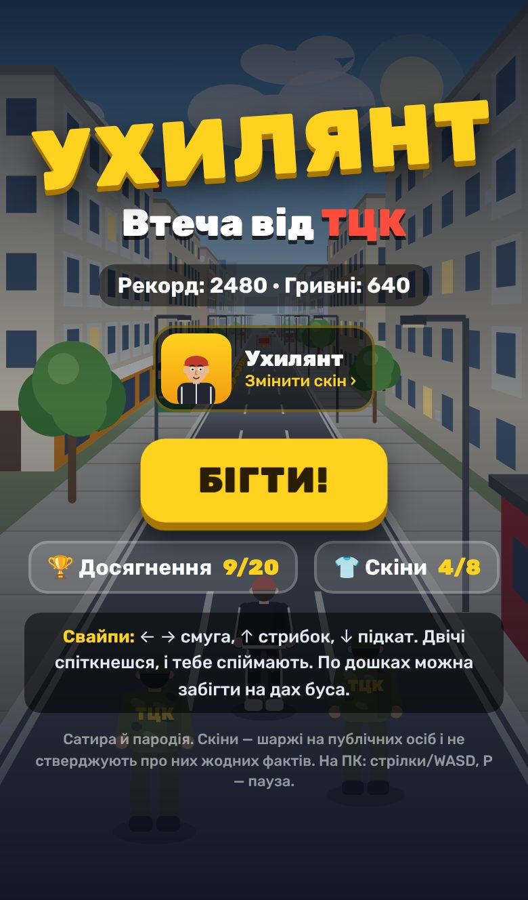
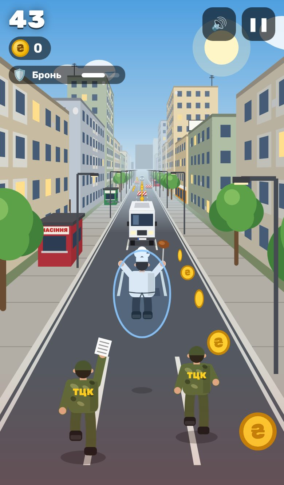
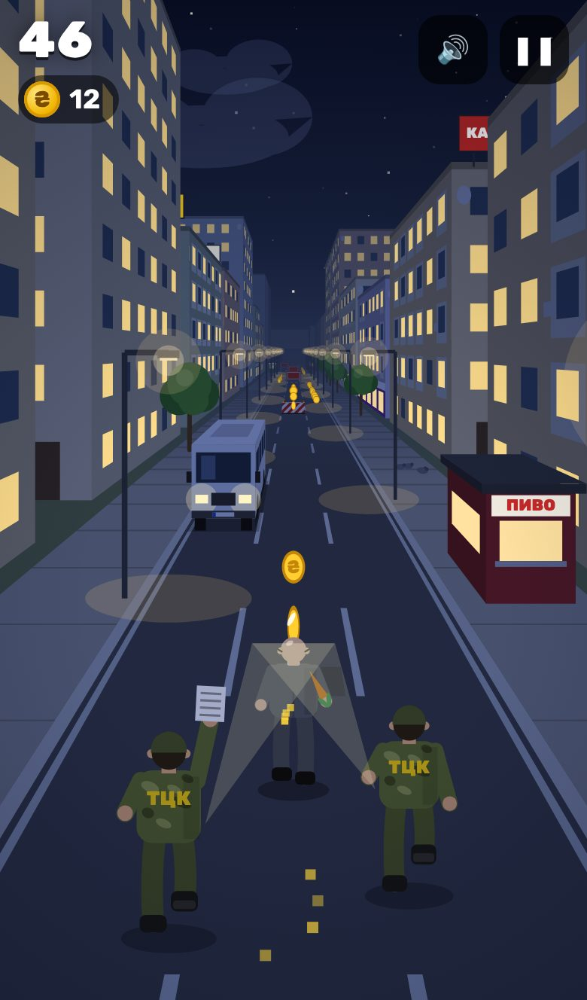
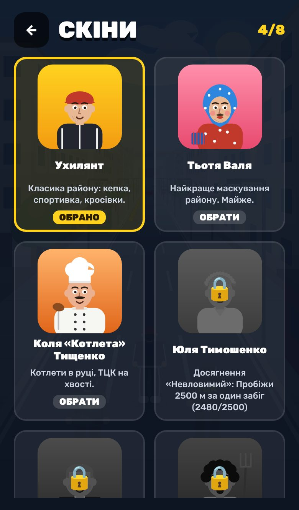

# Ухилянт: Втеча від ТЦК

Сатиричний безкінечний раннер для телефона: ухилянт тікає від ТЦК вулицями панельного району.
Три смуги, свайпи, буси, патрулі з повістками, бабці-інформаторки та цілий набір пасхалок.

<p>
  
  
  
  
</p>

## Як грати

| Дія | Телефон | ПК |
|---|---|---|
| Змінити смугу | свайп ← / → | ← / → або A / D |
| Стрибок | свайп ↑ | ↑, W або пробіл |
| Підкат | свайп ↓ | ↓ або S |
| Пауза | кнопка ❚❚ | P / Esc |

* **Перешкоди:** барикади й ями (перестрибнути), шлагбауми «СТІЙ!» (підкат), буси та патрулі (обійти). По дерев'яних дошках можна забігти на дахи бусів.
* **Спіткнувся** — ТЦК на хвості. Спіткнешся ще раз, поки вони поруч, і тебе спіймають. Лобове зіткнення — одразу кінець.
* **Бонуси:** 🛡️ Бронь (рятує від одного зіткнення), 🧲 Магніт (збирає гривні), 👟 Кросівки (суперстрибок).
* **Небезпеки:** летючі повістки (обійди або пролізь під ними) і бабця-інформаторка, яка кличе ТЦК.
* **День і ніч** змінюються кожні 3 км: вночі світяться вікна, ліхтарі, а в ТЦК з'являються ліхтарики.

## Досягнення та скіни

20 досягнень (два секретні). За деякі відкриваються скіни-шаржі:

| Скін | Як відкрити |
|---|---|
| Ухилянт | доступний одразу |
| Тьотя Валя | секретне досягнення |
| Коля «Котлета» Тищенко | знайди 5 котлет |
| Юля Тимошенко | 2500 м за один забіг |
| Петро Порошенко | 2000 ₴ за всі забіги |
| Олег Ляшко | 1500 м без жодного бонусу |
| Арсеній Яценюк | 40 стрибків за один забіг |
| Михайло Федоров | 5000 м за один забіг (найкрутіша ачівка) |

Прогрес зберігається локально (localStorage) на пристрої.

## Встановлення APK

Готовий APK — у розділі **Releases** репозиторію (або в артефактах GitHub Actions після кожного пушу в `main`).
На Android дозволь «встановлення з невідомих джерел» для браузера чи файлового менеджера й відкрий файл.

## Структура

```
web/            гра: один файл index.html + шрифт Rubik (OFL) для офлайну
android/        Android-обгортка (WebView), Gradle-проєкт
docs/           скриншоти й іконка
.github/        CI: збирає APK і додає його до релізу на тегах v*
```

## Збірка

Потрібні JDK 17+ та Android SDK (platform 34).

```bash
cd android
./gradlew assembleRelease
# APK: android/app/build/outputs/apk/release/app-release.apk
```

Гру можна запустити й у браузері: відкрий `web/index.html` або підніми локальний сервер у папці `web`.

> APK підписано спільним **несекретним debug-ключем** (`android/app/debug.keystore`, паролі `android`),
> щоб локальні й CI-збірки мали однаковий підпис і оновлювались без перевстановлення.
> Для публікації в Google Play створи власний ключ і не клади його в git.

## Дисклеймер

Це сатира й пародія. Скіни — шаржі на публічних осіб; гра не стверджує про них жодних фактів
і не закликає до порушення закону. Усі інші персонажі та події вигадані.

Шрифт Rubik — SIL Open Font License 1.1 (`web/fonts/OFL.txt`).
