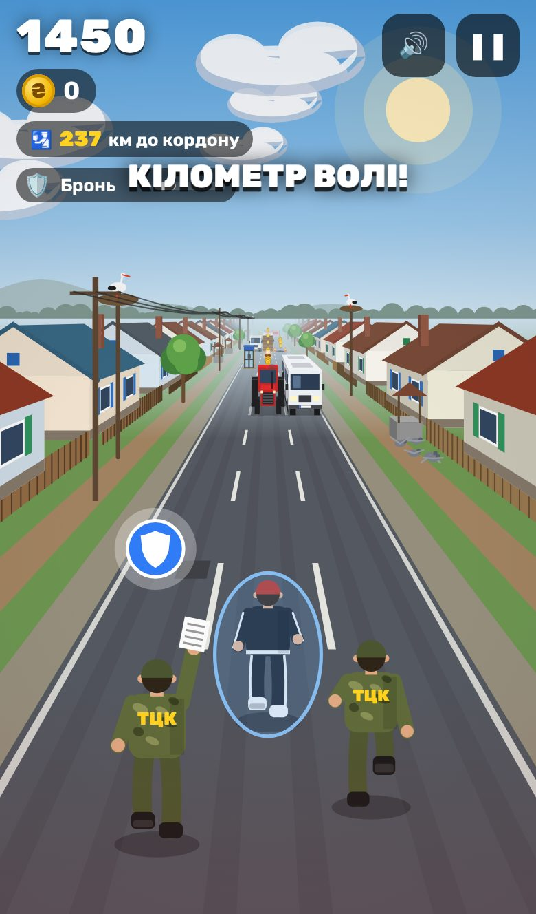
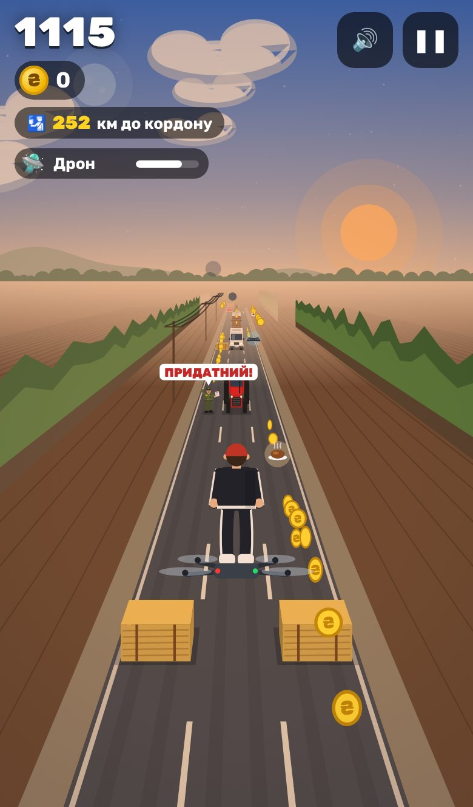
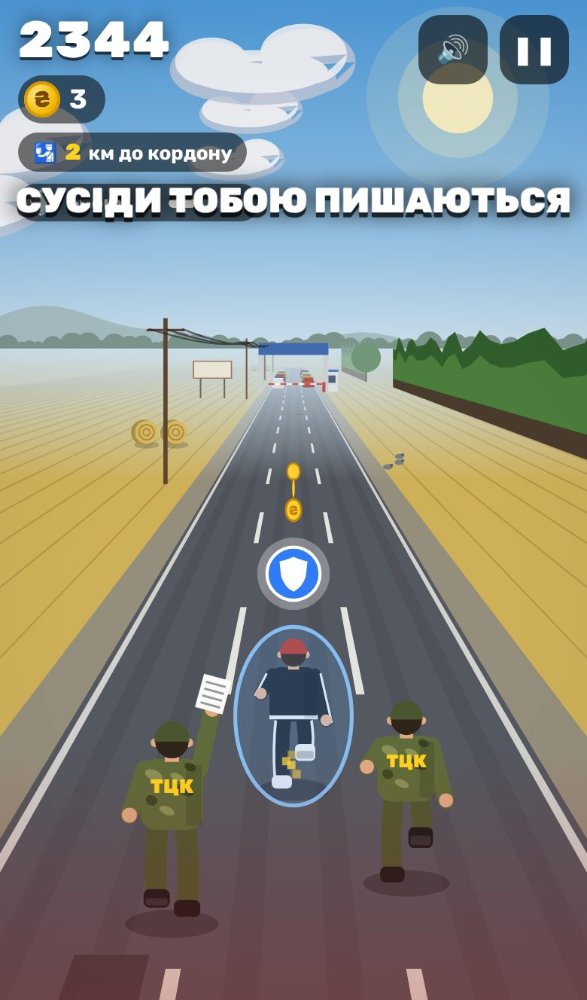
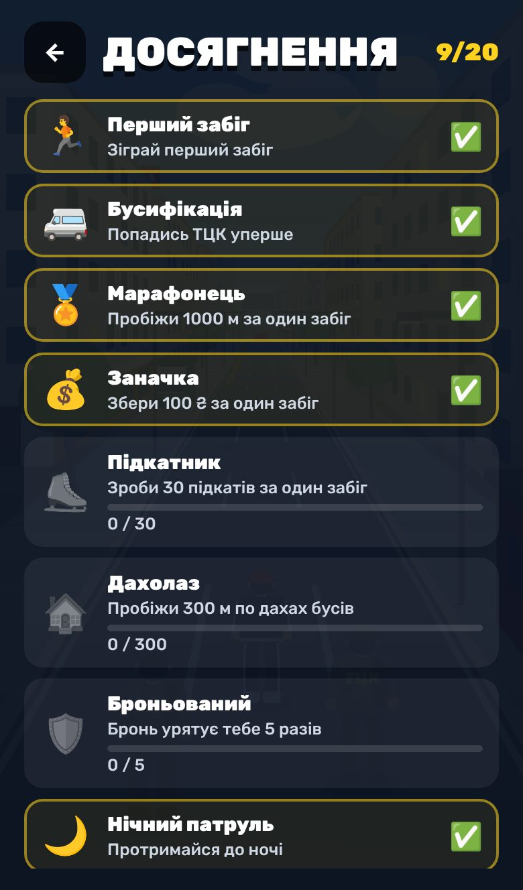

# Ухилянт: Втеча від ТЦК

Сатиричний безкінечний раннер для телефона: ухилянт тікає від ТЦК — вулицями свого міста (у кожного з 14 міст
своя архітектура й пам'ятки), через поля, лісосмуги й села аж до пункту пропуску на кордоні. Три смуги, свайпи, буси, трактори, патрулі з повістками,
таксофон із корешем на «копійці», дрон під обстрілом ППО та цілий набір пасхалок.

<p>
  
  
  
  
</p>
<p>
  
  
  
  
</p>

## Як грати

| Дія | Телефон | ПК |
|---|---|---|
| Змінити смугу | свайп ← / → | ← / → або A / D |
| Стрибок | свайп ↑ | ↑, W або пробіл |
| Підкат | свайп ↓ | ↓ або S |
| Пауза | кнопка ❚❚ | P / Esc |

* **Місто:** проспекти, площі з пам'ятками, бульвари, вузькі вулички з кав'ярнями, парки й будови; на перехрестях дорога повертає. Повороти — візуальні: керування лишається трьома смугами.
* **Маршрут:** обираєш місто старту, а гра рахує кілометри до найближчого кордону з ЄС чи Молдовою. Дорога веде з міста через поля, лісосмуги й села, потім знову містечко — і так до пункту пропуску. Добіг — рідкісна ачівка (а що там на кордоні — побачиш сам).
* **Перешкоди:** барикади, тюки сіна й ями (перестрибнути), шлагбауми «СТІЙ!» (підкат), буси, трактори й патрулі (обійти). По дерев'яних дошках можна забігти на дахи бусів.
* **☎️ Таксофон:** забіжи в будку — 3 секунди дзвониш корешу. Через 30 секунд він під'їде й підкине тебе на кілька кілометрів.
* **🛸 Дрон:** застрибни на дрон і лети над дорогою, але ППО стріляє: червона смуга попереджає, у яку смугу летить ракета — ухиляйся. Зіб'ють — спустишся на парашуті, а ТЦК буде вже поруч.
* **Спіткнувся** — ТЦК на хвості. Спіткнешся ще раз, поки вони поруч, і тебе спіймають. Лобове зіткнення — одразу кінець.
* **Бонуси:** 🛡️ Бронь (рятує від одного зіткнення), 🧲 Магніт (збирає гривні), 👟 Кросівки (суперстрибок).
* **Небезпеки:** летючі повістки (обійди або пролізь під ними) і бабця-інформаторка, яка кличе ТЦК.
* **День і ніч** змінюються кожні 3 км: вночі світяться вікна в хатах і багатоповерхівках, ліхтарі, а в ТЦК з'являються ліхтарики.

## Досягнення та скіни

27 досягнень (чотири секретні), серед них «Біля кордону» і суперрідкісна «Через усю країну» (добігти до кордону з міста за 400+ км). Дистанційні ачівки рахують лише пробіжку — машина й дрон не зараховуються. За деякі досягнення відкриваються скіни-шаржі:

| Скін | Як відкрити |
|---|---|
| Ухилянт | доступний одразу |
| Тьотя Валя | секретне досягнення |
| Коля «Котлета» Тищенко | знайди 5 котлет |
| Юля Тимошенко | 2500 м за один забіг |
| Петро Порошенко | 2000 ₴ за всі забіги |
| Олег Ляшко | 1500 м без жодного бонусу |
| Арсеній Яценюк | 40 стрибків за один забіг |
| Михайло Федоров | 5000 м бігом за один забіг (найкрутіша ачівка) |
| Григорій Сковорода | добіжи до кордону з будь-якого міста |
| Іван Мазепа | секрет (підказка: маршрут одного гетьмана 1709 року) |
| Козак Мамай | секрет (підказка: справжній козак стартує з Січі) |
| Еней з «Енеїди» | добіжи до кордону з міста за 400+ км |

### Міста й відстані

У кожного міста свої фасади, дерева, ліхтарі, транспорт (трамвай / тролейбус / метро), пам'ятки на площах і силует на горизонті:
Київ (сталінки, бані, колона Незалежності, Батьківщина-Мати), Львів (кам'яниці, бруківка, опера, ратуша), Одеса (класицизм,
опера, порт і море), Харків (Держпром), Дніпро (скляні висотки), Запоріжжя (ДніпроГЕС), Вінниця (водонапірна вежа),
Житомир (ракета), Луцьк (замок), Полтава (колона Слави), Чернігів і Суми (храми), Івано-Франківськ (ратуша й Карпати), Миколаїв (верфі).
Вигадані містечка по дорозі — типові.

Від 50 км (Одеса) до 560 км (Харків). Відстані — приблизні, по прямій до найближчого кордону з ЄС чи Молдовою;
у самій грі кілометри рахуються в ігровому масштабі (далеке місто = довший і складніший забіг).

Прогрес зберігається локально (localStorage) на пристрої.

## Встановлення APK

**[⬇ Завантажити останню версію APK](https://github.com/raitodano/ukhylyant/releases/latest/download/ukhylyant.apk)**
(постійне посилання завжди веде на найновіший реліз; усі версії — у розділі **Releases**).

На Android дозволь «встановлення з невідомих джерел» для браузера чи файлового менеджера й відкрий файл.

## Нова версія

Релізи випускаються автоматично (`.github/workflows/android.yml`): кожен пуш у `main` збирає APK,
а якщо для `versionName` з `android/app/build.gradle` ще немає релізу — створюється тег `v<версія>`
і GitHub Release з APK та текстом із `RELEASE_NOTES.md`.

1. Збільш `versionCode` і `versionName` в `android/app/build.gradle`.
2. Онови `RELEASE_NOTES.md`.
3. Запуш у `main`.

## Структура

```
web/            гра: один файл index.html + шрифт Rubik (OFL) для офлайну
android/        Android-обгортка (WebView), Gradle-проєкт
docs/           скриншоти й іконка
.github/        CI: збирає APK і сам випускає реліз для нової версії
```

## Збірка

Потрібні JDK 17+ та Android SDK (platform 34).

```bash
cd android
./gradlew assembleRelease
# APK: android/app/build/outputs/apk/release/app-release.apk
```

Гру можна запустити й у браузері: відкрий `web/index.html` або підніми локальний сервер у папці `web`.

> APK підписано спільним **несекретним debug-ключем** (`android/app/debug.keystore`, паролі `android`),
> щоб локальні й CI-збірки мали однаковий підпис і оновлювались без перевстановлення.
> Для публікації в Google Play створи власний ключ і не клади його в git.

## Дисклеймер

Це сатира й пародія. Скіни — шаржі на публічних осіб; гра не стверджує про них жодних фактів
і не закликає до порушення закону. Гра не містить і не дає жодних порад щодо перетину кордону —
фінал у ній закінчується офіційним пунктом пропуску й жартом. Усі інші персонажі та події вигадані.

Шрифт Rubik — SIL Open Font License 1.1 (`web/fonts/OFL.txt`).
